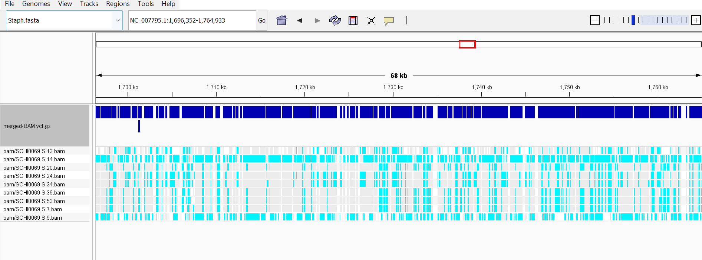
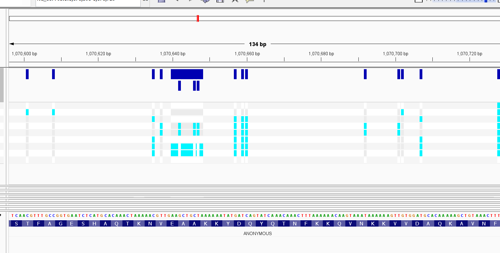

# Assignment 9: Automate Workflows

I am using data from [PRJNA763014](https://www.ncbi.nlm.nih.gov/bioproject/763014) from the Universtiy of the Sunshine Coast in 2021. 

This study investigated: i) within-host diversity of 35 S. aureus strains obtained from 10 participants in the 'Top End' region of the Northern Territory, Australia; and ii) whether commensal strains isolated from these individuals differed from their invasive strains.

## Confirm the Design File

It contains 35 different samples, which I compiled into a "design" csv file using the command. For processing efficiency, I will only be using the first 10 files from this BioProject, however. 


``` 
bio search -H --csv PRJNA763014 > design.csv
```

The design file formating and should have 19 different headings

```
xan headers design.csv
```

should output: 
``` 
0  run_accession
1  sample_accession
2  sample_alias
3  sample_description
4  first_public
5  country
6  scientific_name
7  fastq_bytes
8  base_count
9  read_count
10 library_name
11 library_strategy
12 library_source
13 library_layout
14 instrument_platform
15 instrument_model
16 study_title
17 fastq_url
18 info
```


We care most about the run_accession, but the other information is nice to have too. 

Use 
``` 
xan count design.csv
```

or 

```
cat design.csv | xan view | head
```

To check the number of samples or view an abridged version of the csv. 

## Running a Sample Batch
Ensure that parallel is installed in your pixi environment. 

To run a set number of samples from the design.csv list, run 

``` 
make batch N_SAMPLES=10 N_JOBS=3
```

The number of samples run can be adjusted by changing N_SAMPLES. The processing speed can be set to a number appropriate for your device using N_JOBS. Typically, use the number of cores in your CPU -1. 

Also be aware that you may need to change the number of reads to change coverage for different genomes. This can be done using N=, and is by default set to 200000


An error 1/3 may appear in the output, but this should not affect the results. 

The `make batch` command utilizes:

| Command | Purpose |
|---|---|
| `fasta` | Downloads the FASTA file for the reference genome specified by `REF_GENOME_URL`. |
| `gff` | Downloads the GFF file for the genome specified by `REF_GENOME_URL`. |
| `fastq` | Creates FASTQ files with reads for each sample specified by SRR using `fastqdump`. |
| `qc` | Creates QC data for each sample using `fastqc`. |
| `index` | Uses BWA to index the FASTA file. |
| `align` | Uses BWA and Samtools to generate alignment flag statistics. |
| `variants` | Uses Bcftools `mpileup` to call variants from the BAM files. The `ANN` and `CALL` parameters may need to be changed. |
| `mergeBAM` | Uses Bcftools to create and merge BAM files. It can be substituted by `merge` to merge existing BAM files. |

## Anticipated Results



The "merged-BAM.vcf" file should contain the multi-sample alignment. For the example samples, there is a fair bit of variability across the samples, with samples 14 and 9 showing similiarity. 

There were only a few regions where multiple mutations in the same region were detected. 




