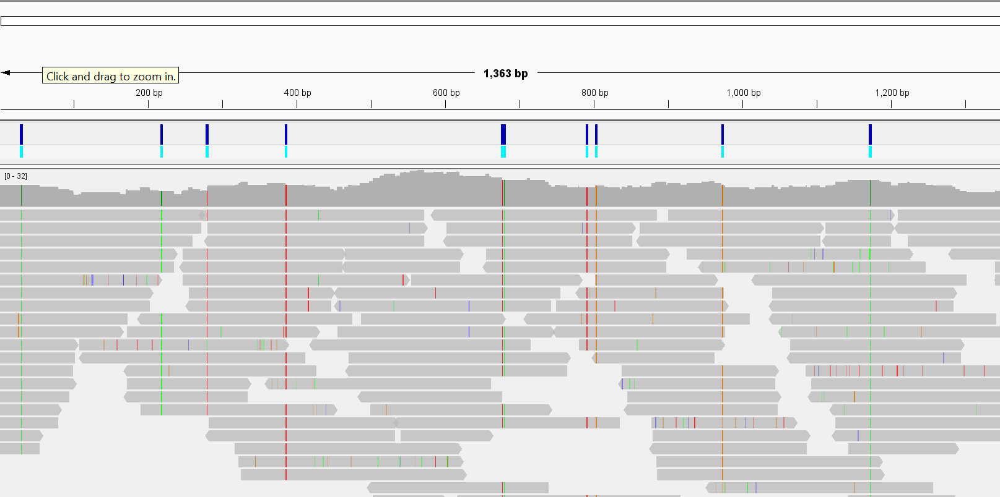
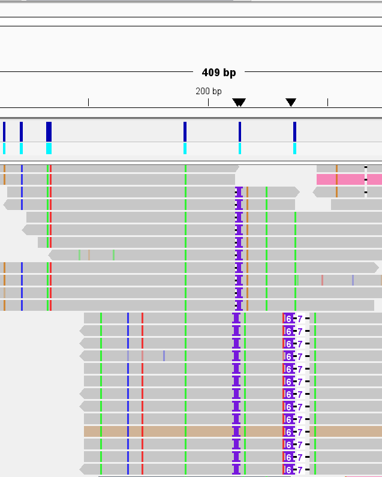

# Assignment 7: Generate a VCF File

This week, I used the *Staphylococcus aureus* genome, since *Paracoccus* had returned limited changes of interest and there are few genome sequences for it. 

[Reference Genome Download](https://ftp.ncbi.nlm.nih.gov/genomes/all/GCF/000/013/425/GCF_000013425.1_ASM1342v1/GCF_000013425.1_ASM1342v1_cds_from_genomic.fna.gz)
 
 I used bio
[SRX33331457](https://www.ncbi.nlm.nih.gov/sra/SRX33331457[accn]) with run identifier SRR38523917. This is from the Federal Research Center for Animal Husbandry in study for the " Search, isolation, genomic and functional studies of pathogenic microorganisms associated with mastitis". Interesting!

I used 200,000 reads, which should put me just a bit above 10x coverage for the 2.8 million bp genome. 

# Makefile use

Running
```
make 
```
will download the FASTA, generate the BAM, and create a VCF file. 

The baseline VCF parameters are

```
bcftools mpileup $(ANN) -O u -f $(FASTA) $(BAM) | \
		bcftools call $(CALL) -mv -O u | \
		bcftools norm -f $(FASTA) -d all -O u | \
		bcftools sort --write-index -O z -o $(VCF)

```

Where 
```d 100 --annotate 'INFO/AD,FORMAT/DP,FORMAT/AD,FORMAT/ADF,FORMAT/ADR,FORMAT/SP'```
and 
```--ploidy 1 --annotate 'FORMAT/GQ'```

These set a maximum depth of 100 per position during the pileup. For higher quality calls, this should be increased at the cost of increasing processing time. The first command adds annotations for the allele and read depths. Because we are using a haploid organism, ploidy =1. 

One can use 
``` make stats```
to generate an excel and pdf with summary statistics for the calls. 

# Variants Present 

42064 variants total were detected, the majority (42149) of which were SNPs, which is typically the most common and least disruptive mutation. 

87 indels were observed.  

``` 
SN      0       number of samples:      1
SN      0       number of records:      42236
SN      0       number of no-ALTs:      0
SN      0       number of SNPs: 42149
SN      0       number of MNPs: 0
SN      0       number of indels:       87
SN      0       number of others:       0
SN      0       number of multiallelic sites:   0
SN      0       number of multiallelic SNP sites:       0
```

# Variant quality 

The transitions/transverions ratio was *1.77* in the summary stats. Because, biologically, we expect a higher number of transitions, good quality calls typically have ratios between 2-3. This sample's is a bit below this, which suggests more transversions than expected and potentially more randomness than we'd expect biologically. This could indicate some issues within the quality. 

However, even  if we filter out calls with a quality below 20 using 
```
bcftools filter -i 'QUAL>20' vcf/sample.vcf.gz \ | bcftools stats
```

the ratio only increases to 1.78.

Additionally, the highest proportion of SNP reads (38601) had an assigned quality of 225.4. Reads below 20 are often filtered, but this is only 364 reads out of the total. Overall, the quality of reads doesn't seem too bad. 

# IGV Visualization 

Visually, variants seemed to be called reasonably, calling only on regions that had a clear consensus across reads. 



I did notice one region where a portion of the reads did not support the proposed indel and multiple reads with an SNP were not called. I wonder if increasing the sequencing depth would eliminate some of these issues. 



