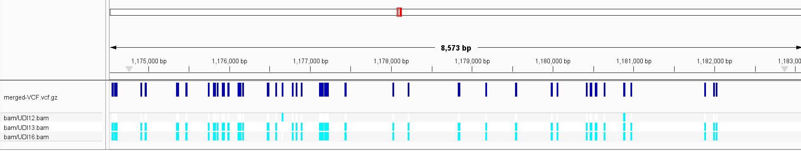
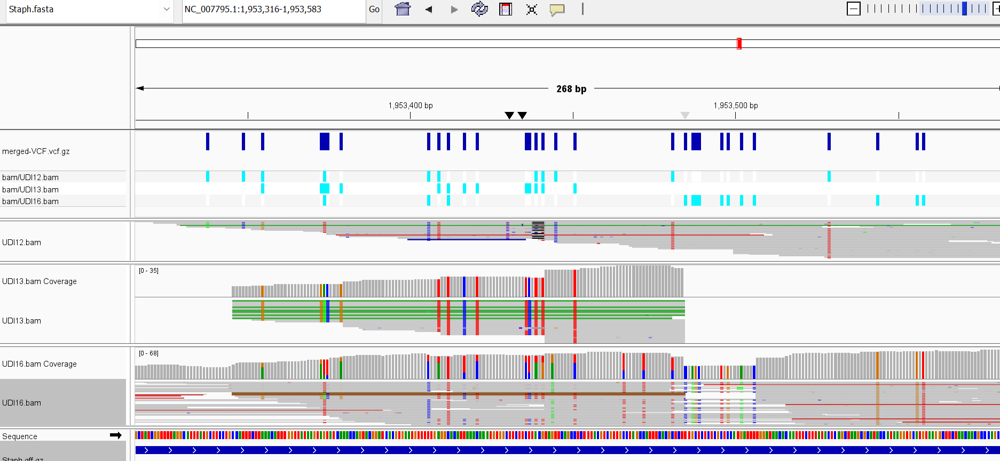
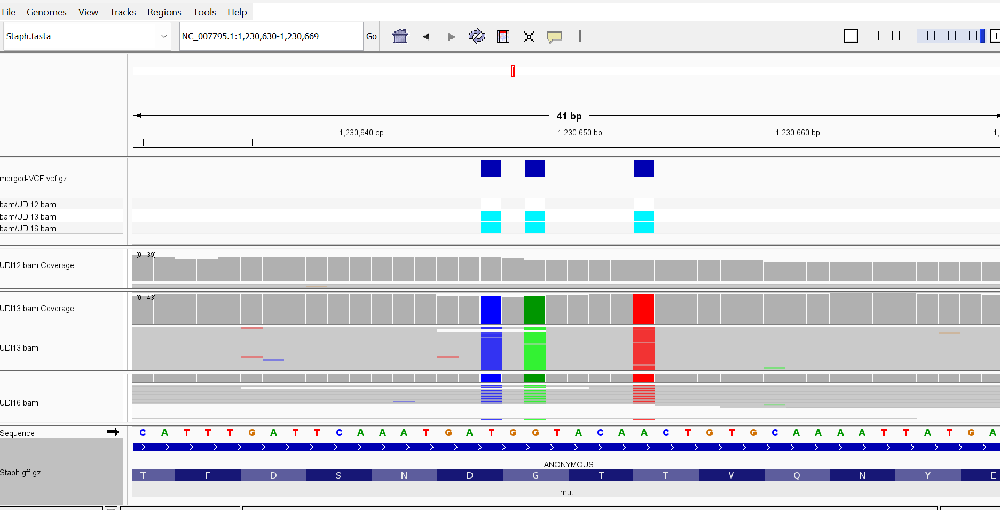

# Assignment 8: Multiple VCF Alignment 


I am using multiple runs from a study from the Federal Research Center for Animal Husbandry looking at milk microbiota.

"The goal of this project is a comparative analysis of the microbiota of milk from cows with mastitis (presumably a subclinical form) and healthy animals in the main dairy regions of the Russian Federation. The establishment of milk microorganisms are typical for the regions of the country, an identification of the content of microorganisms associated with mastitis, as well as to search for commensal microorganisms of normal milk microbiot".  Unfortunately, I couldn't find a direct publication tied to this. 


[Reference Genome Page](https://www.ncbi.nlm.nih.gov/datasets/genome/GCF_000013425.1/)

[Reference Genome Download](https://ftp.ncbi.nlm.nih.gov/genomes/all/GCF/000/013/425/GCF_000013425.1_ASM1342v1/GCF_000013425.1_ASM1342v1_genomic.fna.gz )

[Gff Download](https://ftp.ncbi.nlm.nih.gov/genomes/all/GCF/000/013/425/GCF_000013425.1_ASM1342v1/GCF_000013425.1_ASM1342v1_genomic.gff.gz)


I am using 3 WGS runs of *Staph. aureus* from this project: 

| Sample    | SRR           | Description  |
|-----------|---------------|--------------|
| UDI16     | SRR38523917   | Milk 1       |
| UDI13     | SRR38523918   | Milk 2       |
| UDI12     | SRR38523919   | Milk 3       |


Each sample is from a different milk sample, from my understanding. 

I will first individually calling the variants, creating the VCF files, and then merging them. 

I ran each sample individually, using these three codes individually: 

``` 
make SRR=SRR38523919 SAMPLE_NAME=UDI12 
```

``` 
make SRR=SRR38523918 SAMPLE_NAME=UDI13
```

``` 
make SRR=SRR38523917 SAMPLE_NAME=UDI16 
```

This will download the FASTA, GFF, and create BAM and VCF files for each run. 

Then, use 
```
make merge
 ```

To merge together ALL VCF files that are in the VCF folder. 

## Variant Comparision 

Load the Staph FASTA, GFF, and merged VCF files into IGV. 

Interestingly, sample UDI12 has very few variations from the reference genome, while UDI13 and UDI16 have significantly more variants but are also very similar to each other. 




There were only a few locations where samples UDI13 and UDI16 differed, and many of the differences between variant calling ultimately seemed to come down to issues with coverage, or, a mix of reads with and without the mutations. I'm not sure if this indicates a mix of strains/bacteria in the sample, since they should be haploid? Either way, I'm not convinced that the two samples are particularly different from each other. 



## Variant Effects 

There are a number of point mutations in the mutL gene, which is involved in DNA repair. 



The first changes a GAT to a GAC. Both code for aspartate, so this is a synonomous/silent mutation. 

The second, not being in the wobble position, does change the amino acid, though. Going from GGT to GAT in the samples mutates a glycine to an aspartate. Aspartate can be pretty reactive and does a lot of acid/base chemistry in comparasion to the tiny glycine, so this could be a farily significant structural change. 

Finally, an ACT is mutated to TCT, which converts a threonine to a serine. These amino acids both have similar alcohol groups, so this isn't as dramatic of a change. 

Summary: 

| Original | Mutation| AA change |
|----------|---------|---------- |
| GAT      | GAC     | Silent    |
| GGT      | GAT     | G -> D    |
| ACT      | TCT     | T -> S    |
