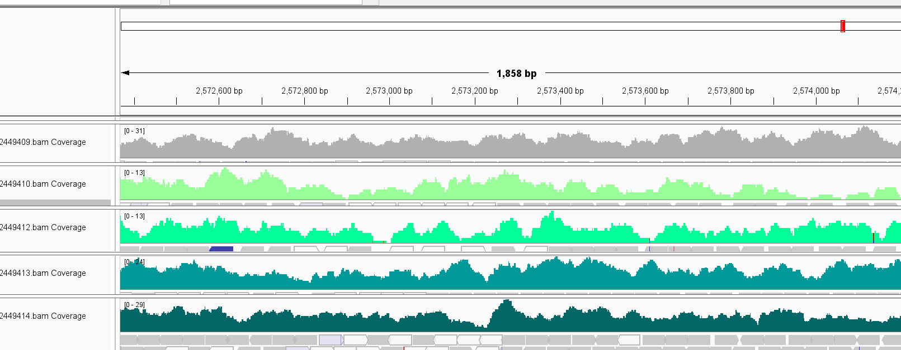

# Assignment 10: Define CHIP-seq peaks 

I am continuing to use my S. aureus genome: 

[Reference Genome Page](https://www.ncbi.nlm.nih.gov/datasets/genome/GCF_000013425.1/)

[Reference Genome Download](https://ftp.ncbi.nlm.nih.gov/genomes/all/GCF/000/013/425/GCF_000013425.1_ASM1342v1/GCF_000013425.1_ASM1342v1_genomic.fna.gz )

[Gff Download](https://ftp.ncbi.nlm.nih.gov/genomes/all/GCF/000/013/425/GCF_000013425.1_ASM1342v1/GCF_000013425.1_ASM1342v1_genomic.gff.gz)


This time, however, I will be looking at CHIP-seq project: [PRJNA360436](https://www.ncbi.nlm.nih.gov/bioproject/360436). 

Briefly, the researchers were looking to find Noc-associated spatial regulators of division, but found along the way that Noc seems to control DNA replication. Noc mutants over-replicate and can be rescued by dnaA mutantations. 

``` Overall design: ChIP-seq experiments were performed on wild type and mutant cells of Staphylococcus aureus HG003 (Herbert et al, 2010 PMID: 20212089), and Bacillus subtilis PY79 (Youngman et al 1983, PMID: 6300908) growing in tryptic soy broth (TSB) and CH, separately, at 37°C with aeration ``` 


The project contains 20 samples total, but some are for *Bacilus subtilus*. There are 6 *S. aureus* samples, one with anti-noc antibodies, and one with anti-6xHis antibodies (SRR5151568, SRR5151569, SRR5151572, SRR5151567, SRR5151570,SRR5151571)

# How to use this Makefile

Run

```
make batch_background
```

To create BAMS for input/controls for each sample. Please note that you must have separate CSVS for each type and they must be in the same order--row 1 in design_background.csv contains the input for sample 1 in design.csv. 

To create BAMs and peaks for each sample, run 

```
make batch
```

Which will use macs3 to pick narrow peaks for CHIP-seq. 
Please note that the default parameters include 
```
--mfold 2 50 \
	--nomodel \
	--extsize 200 \
```
This may be due to a bad dataset, where I consistently got errors 
```
"total number of paired peaks: 60
WARNING @ 02 Nov 2026 00:12:20: [93 MB] #2 MACS3 needs at least 100 paired peaks at + and - strand to build the model, but can only find 60! Please make your MFOLD range broader and try again. If MACS3 still can't build the model, we suggest to use --nomodel and --extsize 147 or other fixed number instead.
WARNING @ 02 Nov 2026 00:12:20: [93 MB] #2 Process for pairing-model is terminated!"
```

Mfold decreases the fold change between control and data to be between just 2-50X difference. A 10x difference would be much more rigorous and pick peaks more selectively. 

nomodel forces macs3 to pick peaks even if it is below the 100 pair thershold. 


| Command | Purpose |
|---|---|
| `fasta` | Downloads the FASTA file for the reference genome specified by `REF_GENOME_URL`. |
| `gff` | Downloads the GFF file for the genome specified by `REF_GENOME_URL`. |
| `fastq` | Creates FASTQ files with reads for each sample specified by SRR using `fastqdump`. |
| `qc` | Creates QC data for each sample using `fastqc`. |
| `index` | Uses BWA to index the FASTA file. |
| `align` | Uses BWA and Samtools to generate alignment flag statistics. |
| `wiggle` | Creates lighter-load Bigwig files from BAM files |
| `genomecount` | Uses faCount on the reference genome to calculate the correct working genome size |
| `chip_peak` | Picks peaks using macs3 callpeak |
| `background` | Runs fasta gff fastq index align |
| `chip` | Runs fasta gff fastq qc index align genome_count chip_peak |


# Peak Assesment

When I loaded the CHIP-seq data into IGV, I initially noted that coverage tended to be pretty heavy throughout the entire genome, though there were regions with very little coverage. 



Some peaks that were picked from the samples made sense and could reasoanbly be of biological significance 


while others seemed to pick random noise. This could likely be due to the very lenient parameters I set in an attempt to get the required number of pairs. 


