# Assignment 11: Evaluate Gene Expression

I am assessing RNA seq data from the Universal Human Reference (UHR), from cancer cell lines and the Human Brain Reference (HBR), from brains. We would expect to see neuron/brain specific transcripts in the latter. 

## How are the two sample types different?

Initially, I was concerned that there was little difference between the two datasets, as most areas with coverage in one set had coverage in another. However, the amount of covereage changed significantly between some samples. For example, in the PATZ2 gene. I think this makes sense--usually, RNAseq data only returns a couple dozen-1000s of genes that are signficantly changes, so we'd expect the majority of transcripts to remain the smae. 

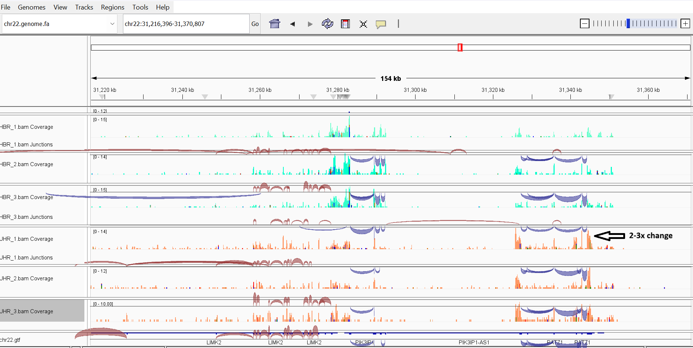

However, even if coverage patterns were often similar, the coverage amount did vary across samples. In the gens MYH9, for example, the top coverage is about 16 in the HBR samples and 50 in the UHR samples. I'm not sure if these are changes that could get normalized out later or consequences of differences in total RNA quality/quantity, but this seems like a significant change.

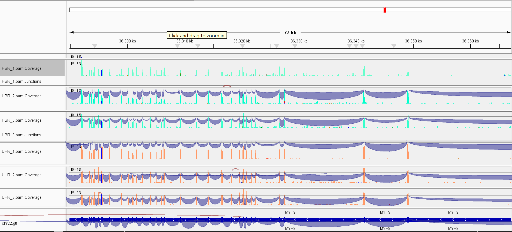

The change is even more visible if you set all the coverage to the same scale instead of autoscaling. 

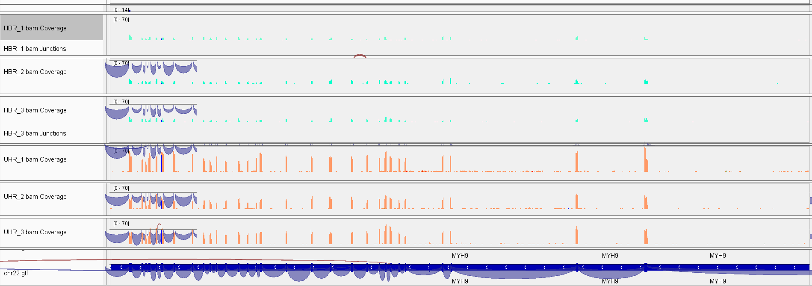

I did notice a few instances, like in MPED11, where there was expression of a completely absent transcript. A quick google search tells me this is a metallophosphoesterase that is strongly enriched in the brain, so this makes sense.

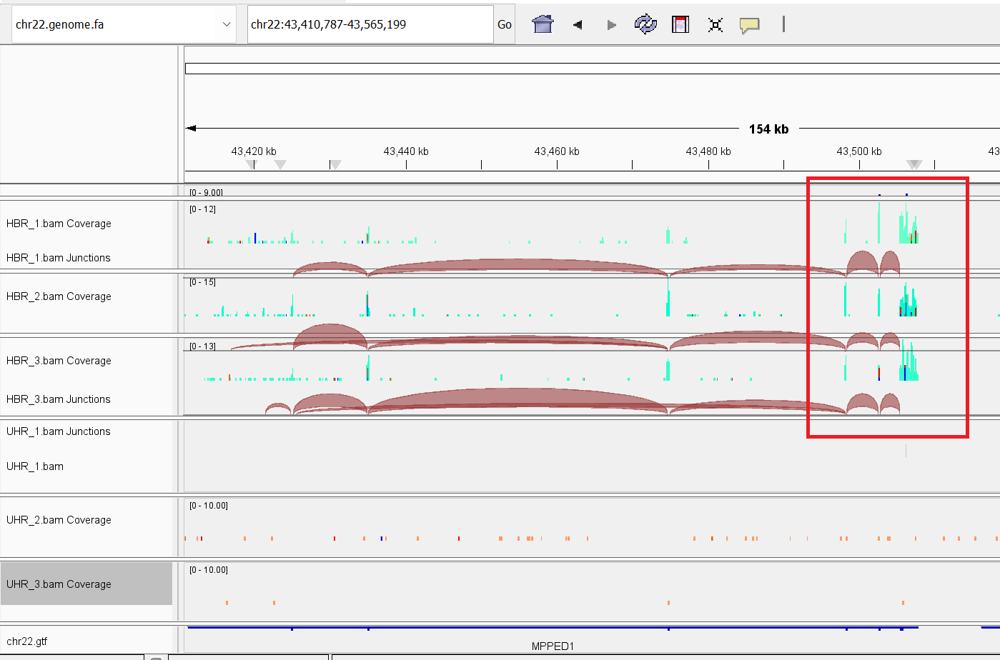

## How consistent are the replicates?

Generally, as in the images above, I found the 3 replicates to have similar patterns--the same regions would have high coverage across samples. However, the number of max coverage would vary across the three replicates, however, such as the range of 185-255 in the UHR samples for the MIF gene below. I did notice that consistently, replicate 2 of the UHR showed a lower coverage and could indicate a lower abundance sample.

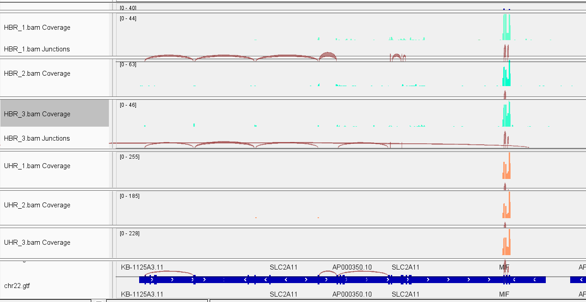

However, I did find a few instances where there was some deviation in patterns. For example, in gene PRR34 below, where replicate 2 of the UHR does not have the same peak as sample 3. 

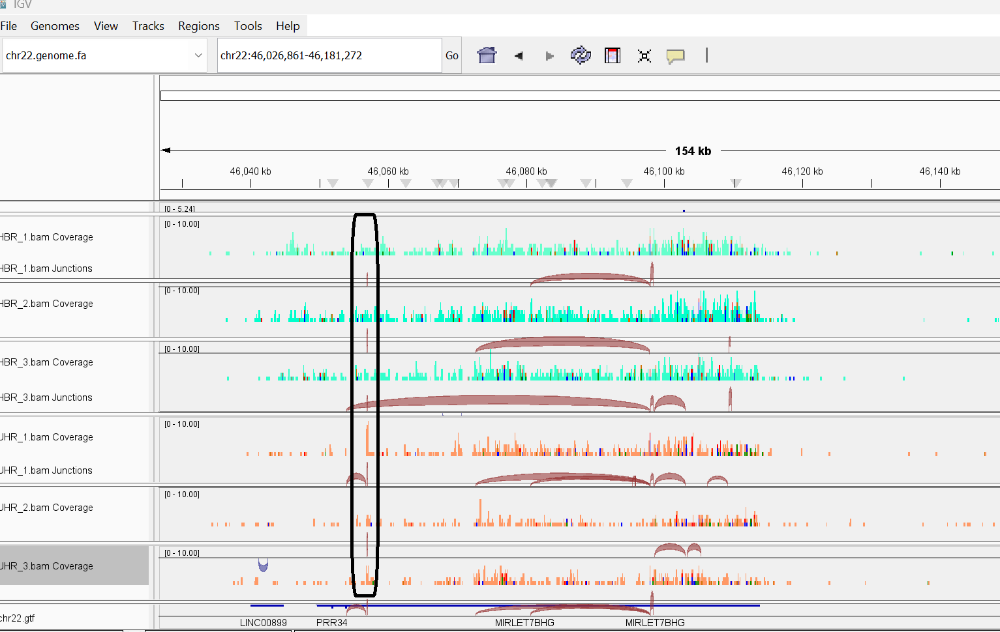

Similarly, although at very low levels, sample 2 did show some unique transcipts other samples lacked.

So, I would characterize them as pretty consistent, but with some differences in coverage amount and regions only occasionally. This underlines the importance of several replicates.

## Genes not expressed in any of the samples.

GGTLC3, as well as its neighboring genes, showed essentially no coverage. Any reads that did map to that region are extremely low and I am attributing to noise. It appears to be expressed more in the endocrine, renal, and male reproductive systems, so it seems reasonable expression would be lacking in our samples.

## Coverage of strongly expressed genes

DRG1 shows moderate expression in each of its exons in all 6 samples. It appears to be related to mitocondrial health and microtubule dynamics, so I strong baseline expression would be reasonable. 

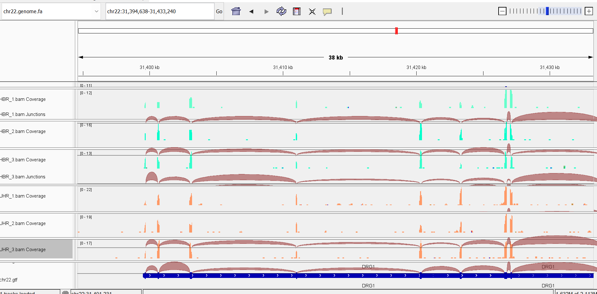

An even higher abundance transcript is for RPL3, a ribosomal subunit for which high transcription makes a lot of sense. Coverage ranges from 100-500+ for this gene!

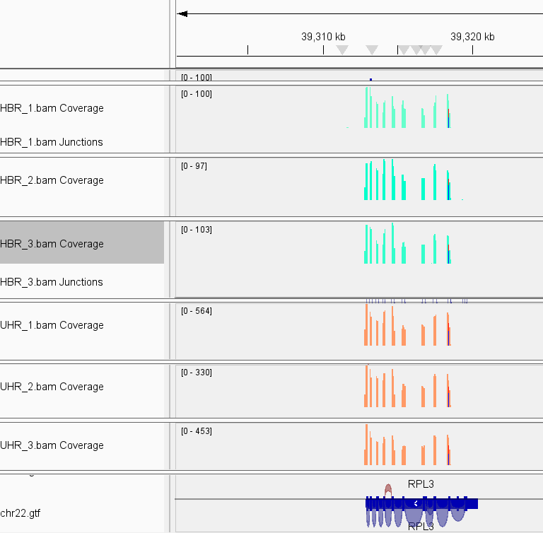

## Can you identify the transcripts that are expressed?

Based on the different isoforms, expression is really only of the top transcript. There isn't really covereage for the first exon that is in many of the other transcripts, or for the extended exons circled that go beyond the covereage regions. 

The coverage for each exon is also quite similar, which makes me think there are no shorter transcripts and its consistent expression of one type of transcript isoform. 

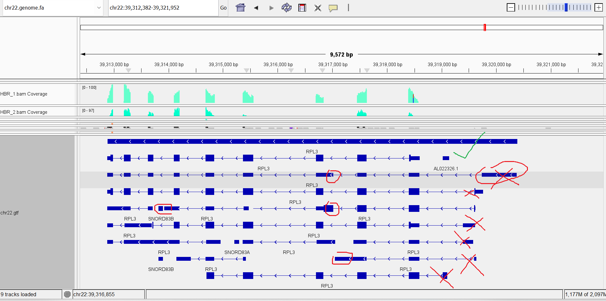

## Can you find a gene/transcript where the expression is clearly different between the two sample types? What is the fold change? Is the transcript upregulated or downregulated?

Something I thought that was really cool was that IGLJ3 showed even higher coverage than RPL3 at 1000+ in the UHR samples, but was absent from the brain samples. This is an immunoglubin gene, so it makes sense it's missing in the brain! Assuming our "B" is the brain sample and our "A", or reference, is the UHR samples, this gene is *downregulated*. The fold change would be about 100-150, since there may be some slight, ~10x coverage in the brain samples still. 

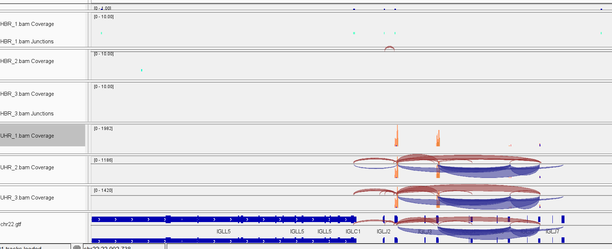

YWHAH is expressed higher in the HBR samples (117-173x coverage) compared to the UHR samples (27-41x coverage) for about a 3x fold *upregulation* . I couldn't find specific neuronal functions, but it does seem to be involved in signal transduction. 

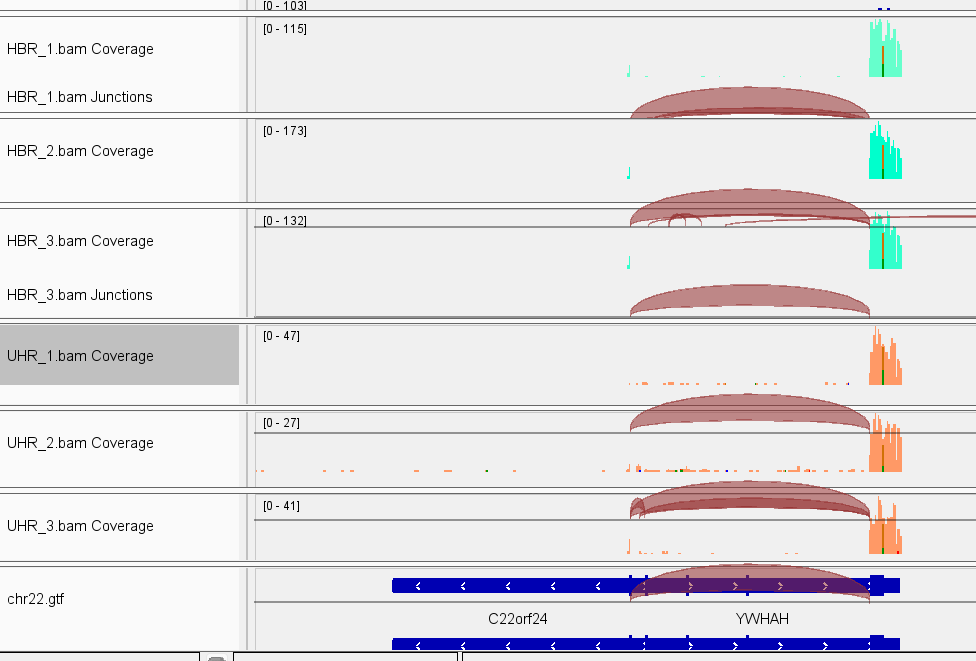

## How certain are you that it is not a random fluctuation? Why?

When perusing the data, most random coverage that was inconsistent across samples appeared to be in the 10x range. It is pretty unlikely that coverage would randomly increase by 3x, especially across 3 samples consistently, unless it was a real biological difference. This is, of course, why we strive to have more biological replicates, though, and why we look at volcano plots that take into account both p-values and fold-changes when looking at RNA-seq data. If data fluctates a lot between samples, the p-value will be low. If the change itself is not biologically relevant, the fold-change will generally be low. 